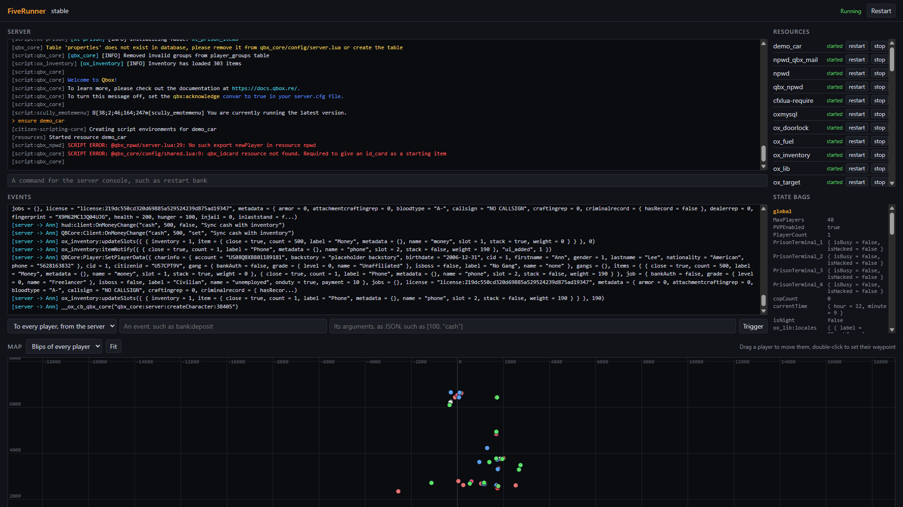
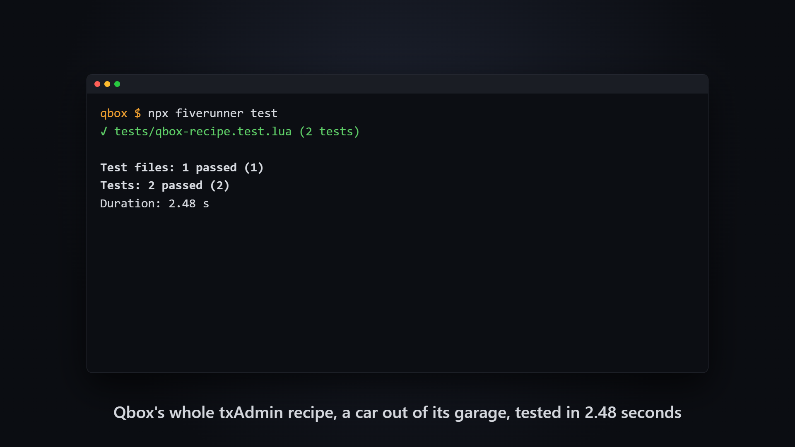
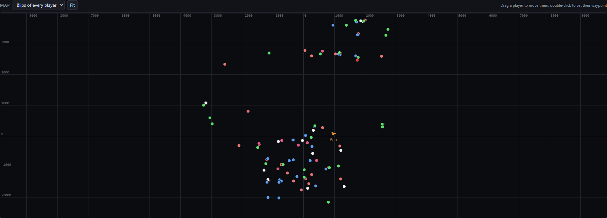
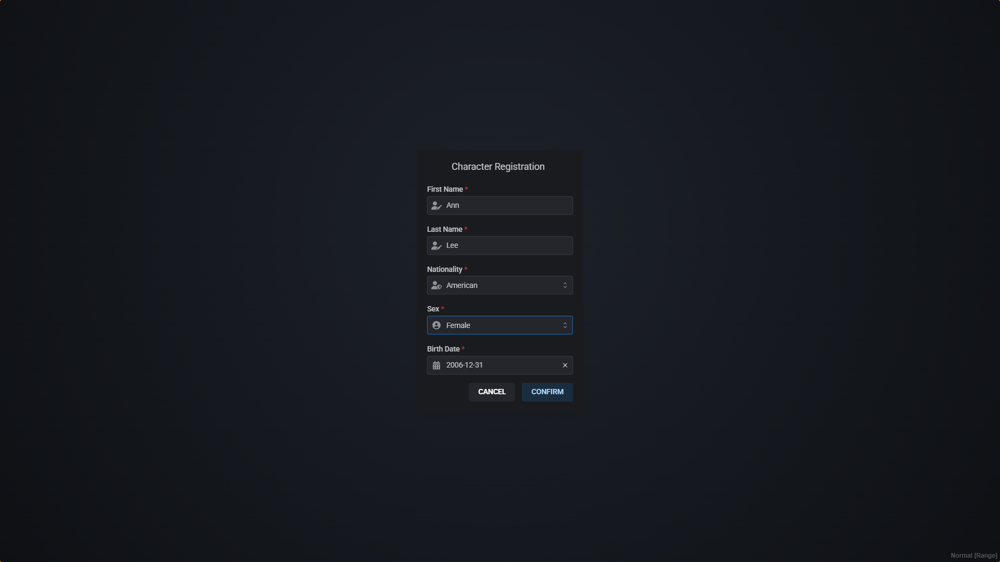
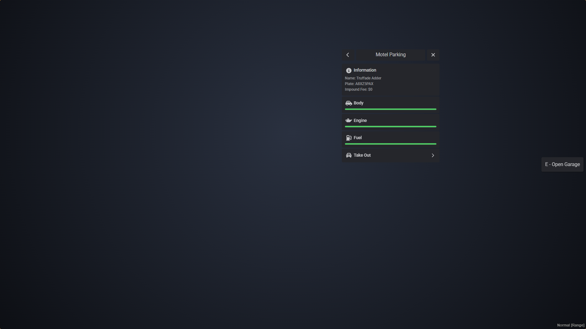

# FiveRunner

Run FiveM resources in your browser and in CI. No GTA V, no FXServer, no restarts.

> **Status:** early development. `npx fiverunner test` runs the Lua tests of FiveM resources in Node, and `npx fiverunner dev` runs resources and their NUI in your browser. Watch the repository to follow along.



[Watch the demo](https://github.com/DariusHQ/fiverunner/releases/download/v0.6.0/fiverunner.mp4) (84 seconds): the whole Stable recipe of Qbox for txAdmin, tested, then in the dev UI, where a player registers a character, is dragged to a garage on the map, presses E and takes her car out.

## Testing resources

Start with a test that your resource or server starts without script errors, and a GitHub workflow that runs it on each push:

```bash
npx fiverunner init
```

Write tests in files whose names end in `.test.lua`, next to your resource:

```lua
describe('bank', function()
    it('takes deposits', function()
        local ann = fiverunner.connect({ name = 'Ann' })
        ann:emit('bank:deposit', 100)
        expect(exports.bank:balance(ann.id)).toBe(600)
    end)
end)
```

Then run them, on your machine or in GitHub Actions:

```bash
npx fiverunner test
```



Each test gets a server of its own, with your resources started, and players whose clients run your client scripts. Resources that use oxmysql get a database of their own, in memory, that speaks MariaDB's SQL and starts with the tables of your `.sql` files. Time moves as fast as it can, so tests that wait take no time. [docs/testing.md](docs/testing.md) tells all that tests can do, and [examples/bank](examples/bank) is a resource with tests.

## Developing resources

Run your project in your browser:

```bash
npx fiverunner dev
```

The dev UI has the console of your server, where you run commands, its resources, which you start, stop and restart, the events that the server and the players send each other, which you trigger too, its state bags, and a map of its entities and of the blips of the players, where you drag players to move them. Connect players, whose clients run your client scripts, each with a screen that shows the frames of its NUI: click through your pages, which talk to your callbacks as they do in FiveM. As you save files, the dev UI restarts the resources that they belong to, and the players stay. [docs/dev.md](docs/dev.md) tells all that it does.



## Frameworks

QBox and ESX run on FiveRunner: CI runs qbx_core, ox_lib, ox_inventory, qbx_vehicles and es_extended, as they are released, on every change, with players who log in, earn money, carry items, get jobs and are saved as they leave. [docs/compatibility.md](docs/compatibility.md) lists what passes.

So does the whole Stable recipe of Qbox for txAdmin, with its 43 resources: they start without errors but those of npwd, whose phone is JavaScript, which FiveRunner does not run, and a player takes a car out of a garage of qbx_garages, as [the tests of the demo](scripts/demo/qbox-recipe.test.lua) check.





## Planned

- A playground in the browser, which runs resources without installing anything.

## How it works

Your scripts run on CfxLua, the Lua 5.4 runtime FiveM ships, compiled to WebAssembly: the same syntax extensions, vectors and quaternions, `json` and `msgpack`. Each resource gets its own Lua state, one per side and per player, the same isolation FiveM gives you. On top of that, FiveRunner reimplements the Cfx scripting runtime: events with `source` and net-safety, exports, function references, state bags, threads and `Wait`, and the natives API.

Servers also get FiveM's own `io` and `os` libraries, its VFS and file permissions, its HTTP client and server, its server variables and its console, and oxmysql, whose exports run on SQLite, which FiveRunner teaches MariaDB's SQL.

## Differences from FiveM

FiveRunner follows FiveM's Windows server and its clients down to their error messages and their quirks. Where it differs, on purpose or for now, [docs/differences.md](docs/differences.md) says so.

## Clean room

FiveRunner's scripting runtime is a clean-room implementation and contains no code from the FiveM platform. CfxLua and its libraries are open source; see [THIRD_PARTY_NOTICES.md](THIRD_PARTY_NOTICES.md). FiveRunner is not affiliated with or endorsed by Cfx.re, Rockstar Games or Take-Two Interactive.

## License

[MIT](LICENSE)
