<p align="center">
  <a href="https://dariushq.github.io/fiverunner/"><picture><source media="(prefers-reduced-motion: reduce)" srcset="https://raw.githubusercontent.com/DariusHQ/fiverunner/main/docs/media/banner.png">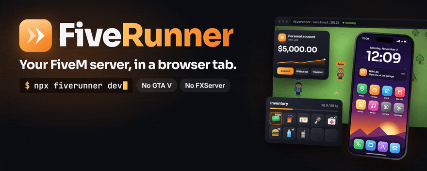</picture></a>
</p>

<p align="center">Run FiveM resources in your browser and in CI.<br>No GTA V, no FXServer, no restarts.</p>

<p align="center">
  <a href="https://dariushq.github.io/fiverunner/"></a>
  <a href="https://www.npmjs.com/package/fiverunner"></a>
  <a href="https://github.com/DariusHQ/fiverunner/actions/workflows/ci.yml"></a>
  <a href="https://github.com/DariusHQ/fiverunner/blob/main/LICENSE"></a>
</p>

> Where a resource behaves differently than in FiveM, [tell us](https://github.com/DariusHQ/fiverunner/issues/new/choose).

## Quick start

**[Try it in your browser](https://dariushq.github.io/fiverunner/)**, with nothing to install: a small city, in Lua and JavaScript, that runs in the page. Edit its files, press Run, and walk around it. Or run [a resource of GitHub](#resources-of-github-in-your-browser) in it.

On your machine, with Node 22 or later, in the folder of a resource or of a server, the one with `server.cfg` and `resources`:

```bash
npx fiverunner dev
```

Open the address that it prints, connect a player, and click through your NUI, as your files change. A script that needs a framework runs in the folder of its server, next to the framework. To test it on every push, add a test and a GitHub workflow, then run it:

```bash
npx fiverunner init
npx fiverunner test
```

**[Watch the demo](https://github.com/DariusHQ/fiverunner/releases/download/v0.9.0/fiverunner.mp4)** (122 seconds, with sound): the whole Stable recipe of Qbox for txAdmin, tested, then in the dev UI, where a player registers a character, dresses her in illenium-appearance, opens ox_inventory and the bank of Renewed-Banking, and is dragged across the map to a garage, where she takes her car out.

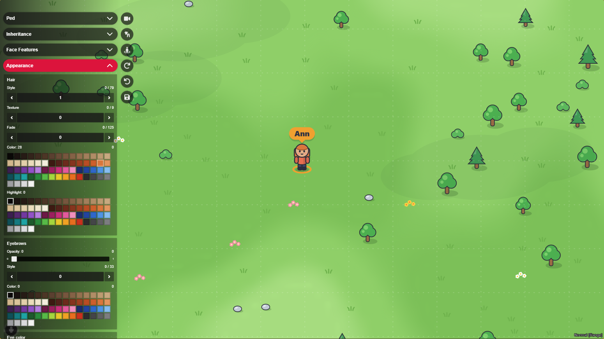

- **Real resources, as they are released.** The 43 resources of the Stable recipe of Qbox start on your machine in seconds: its core, its inventory, its garages, its bank, and its phone, which is JavaScript.
- **Real NUIs.** Your pages run in a browser, and talk to your callbacks as they do in FiveM: the appearance editor, the inventory, the bank and the phone of the recipe work as players use them.
- **Tests in CI.** Each test gets a server of its own, players, and a database in memory, and time moves as fast as it can.
- **A world to look at.** Under the frames of NUI, the screen of each player shows the world round their ped, as a cartoon or in the style of GTA V, and the cartoon dresses them as your scripts do.

## Resources of GitHub, in your browser

The playground runs the resources and servers of GitHub too, which `?gh=` and the name of a repository after its address name, such as [overextended/ox_target](https://dariushq.github.io/fiverunner/?gh=overextended/ox_target), [qbcore-fivem/qb-core](https://dariushq.github.io/fiverunner/?gh=qbcore-fivem/qb-core) or [Qbox-project/qbx_core](https://dariushq.github.io/fiverunner/?gh=Qbox-project/qbx_core), with `@` and a branch or a tag after the name, and the directory of a resource after a slash. It reads them from GitHub with the resources that they need, as far as it knows where those are: ox_lib, ox_target and ox_inventory, qb-core, qb-target, qb-weapons, qb-menu and qb-input, qbx_core and qbx_vehicles, es_extended and the tables of ESX, and PolyZone. Scripts that use the exports of a framework or of a target, without their manifests naming it, get it too, and ox_inventory gets Qbox when nothing brings a framework. A link brings others with `&with=owner/repo`.

Put its button in the README of your resource, and people run it with a click:

[](https://dariushq.github.io/fiverunner/?gh=overextended/ox_target)

```markdown
[](https://dariushq.github.io/fiverunner/?gh=owner/repo)
```

The playground gives the Markdown of the button of each repository that it runs. [docs/differences.md](docs/differences.md#the-playground) tells what it leaves out.

## Testing resources

Start with a test that your resource or server starts without script errors, and a GitHub workflow that runs it on each push:

```bash
npx fiverunner init
```

Write tests in files whose names end in `.test.lua`, next to your resource:

```lua
describe('bank', function()
    it('takes deposits', function()
        local ann = fiverunner.connect({ name = 'Ann' })
        ann:emit('bank:deposit', 100)
        expect(exports.bank:balance(ann.id)).toBe(600)
    end)
end)
```

Then run them, on your machine or in GitHub Actions:

```bash
npx fiverunner test
```

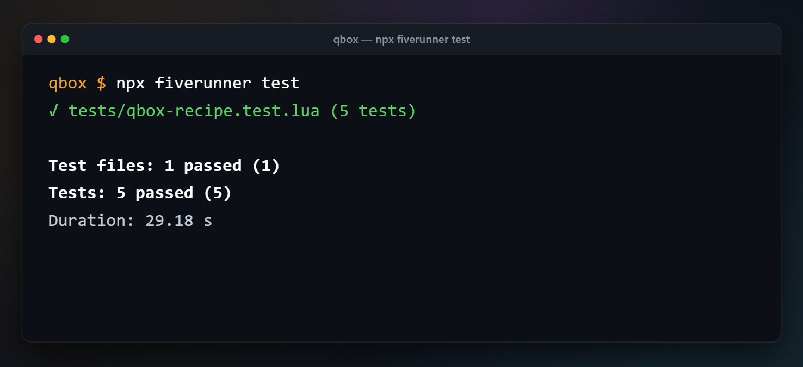

Each test gets a server of its own, with your resources started, and players whose clients run your client scripts. Resources that use oxmysql get a database of their own, in memory, that speaks MariaDB's SQL and starts with the tables of your `.sql` files. Time moves as fast as it can, so tests that wait take no time. `--coverage` writes the lines of Lua that they ran, for lcov, and `--junit` a report for your CI. [docs/testing.md](docs/testing.md) tells all that tests can do, and [examples/bank](examples/bank) is a resource with tests.

## Auditing servers

Find the events of your server that trust their clients, before cheaters do:

```bash
npx fiverunner audit
```

A player logs in, triggers each event that clients may trigger with the arguments that cheaters give, and the audit tells what any client gains, such as money, items or a job, what it changes in the database, and what breaks. It exits with 1 when any client gains something, so CI can fail on it. [docs/audit.md](docs/audit.md) tells how it works and what it cannot see.

## AI assistants

Let Claude Code, Cursor or VS Code run your resources as they write them, so they check what your scripts do in place of guessing:

```bash
claude mcp add fiverunner -- npx -y fiverunner mcp
```

On Windows, give `cmd /c npx` in place of `npx`. `fiverunner mcp` serves the Model Context Protocol. Its tools describe what the server started, run your tests, run Lua against a fresh server of your project, with players that join and trigger events, and audit its events. [docs/mcp.md](docs/mcp.md) tells how to set it up in each assistant.

## Developing resources

Run your project in your browser:

```bash
npx fiverunner dev
```

The dev UI has the console of your server, where you run commands, its resources, which you start, stop and restart, the events that the server and the players send each other, which you trigger too, its state bags, an inspector of what each resource has and of the time it takes, with a box that runs code inside it, and a map of its entities and of the blips of the players, classic, as a cartoon or in the style of GTA V, where you drag players to move them. Connect players, whose clients run your client scripts, each with a screen that shows the frames of its NUI over the world round their ped: click through your pages, which talk to your callbacks as they do in FiveM, and walk or drive with W, A, S and D. As you save files, the dev UI restarts the resources that they belong to, and the players stay. [docs/dev.md](docs/dev.md) tells all that it does, and [examples/city](examples/city) is a small server to play it on: citizens move in through a card, buy food, take a car out, and write to each other on a phone in JavaScript.

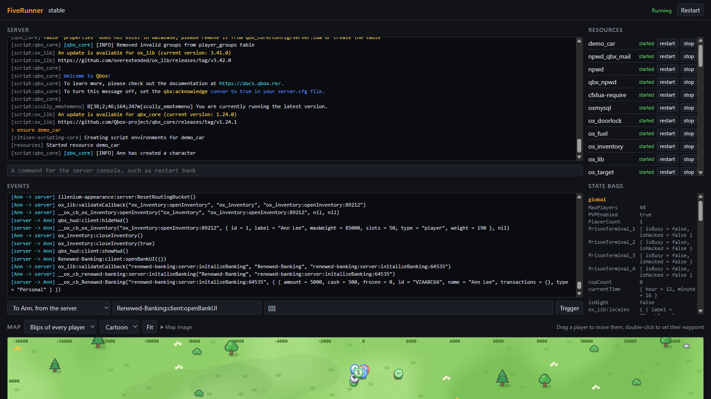

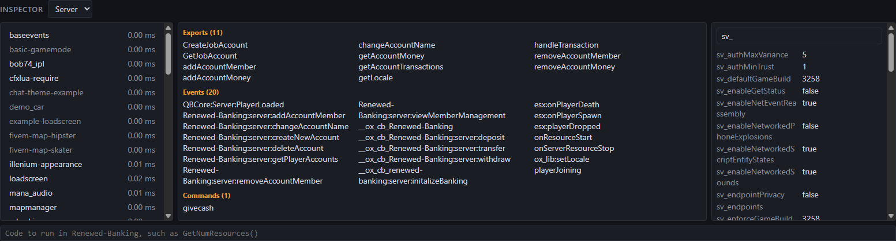

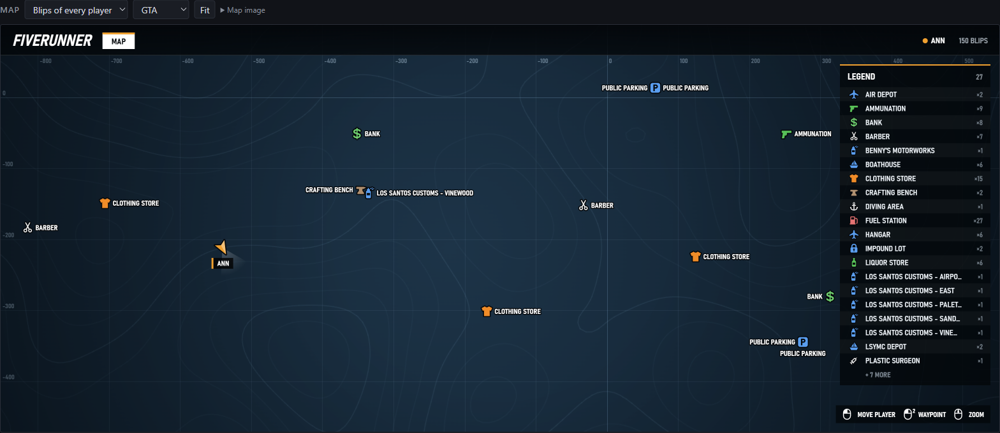

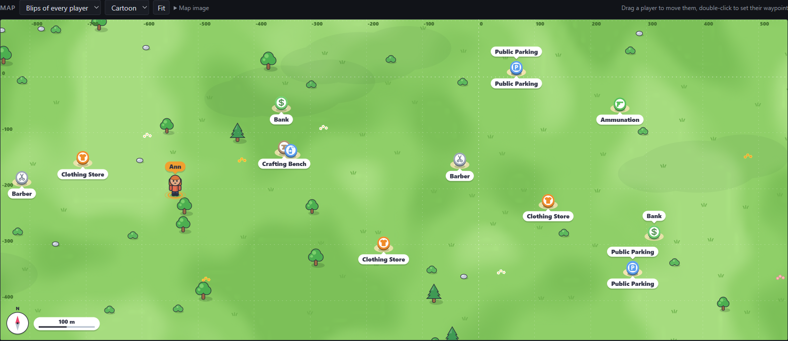

## Frameworks

QBCore, QBox and ESX run on FiveRunner: CI runs them, as they are released, on every change, with players who log in, earn money, carry items, get jobs and are saved as they leave. [docs/compatibility.md](docs/compatibility.md) lists what passes.

The whole recipe of QBCore for txAdmin runs too, with its 72 resources, without errors. A player creates a character in qb-multicharacter, picks where to start in qb-spawn, gets dressed in qb-clothing, opens qb-inventory and qb-banking, and takes a car out of qb-garages, with what the database keeps of it, as [its tests](compat/qbcore/tests/qbcore.test.lua) check.

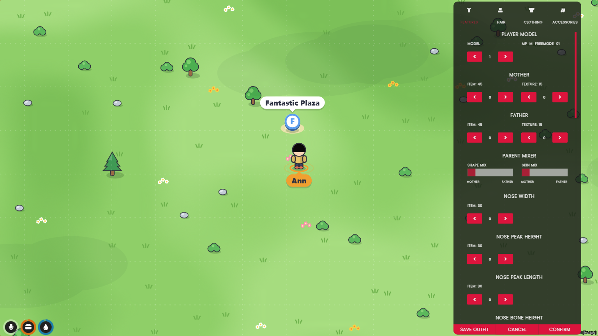

So does the whole Stable recipe of Qbox for txAdmin, with its 43 resources, without errors. A player takes a car out of a garage of qbx_garages, picks clothes in illenium-appearance, opens ox_inventory and the bank of Renewed-Banking, and keeps a contact in the phone of npwd, whose server is JavaScript that talks to the database with its own mysql2, as [its tests](compat/qbox-stable/tests/recipe.test.lua) check, which CI runs on every change.

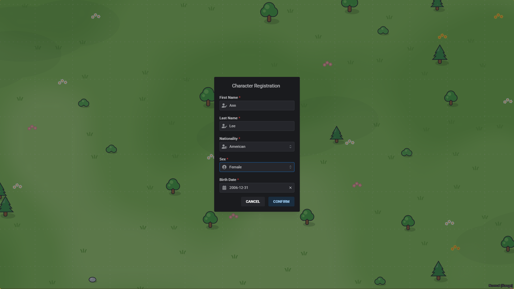

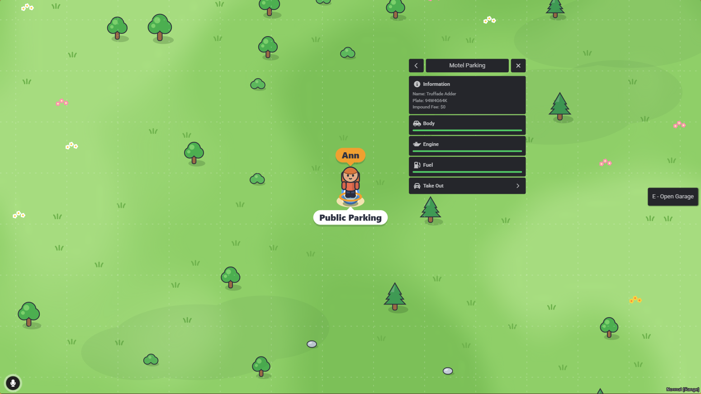

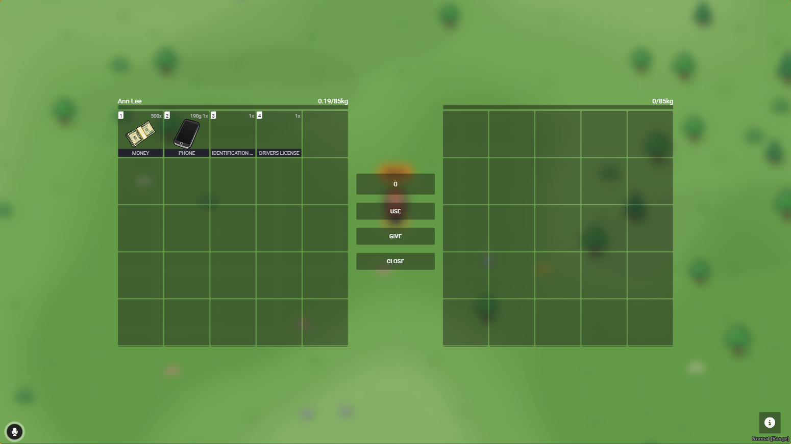

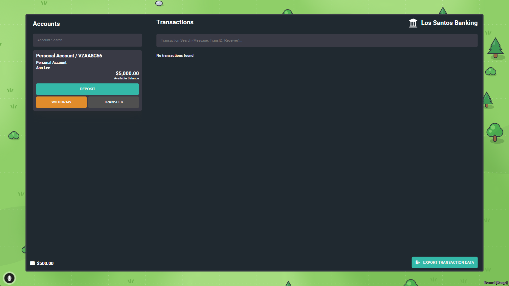

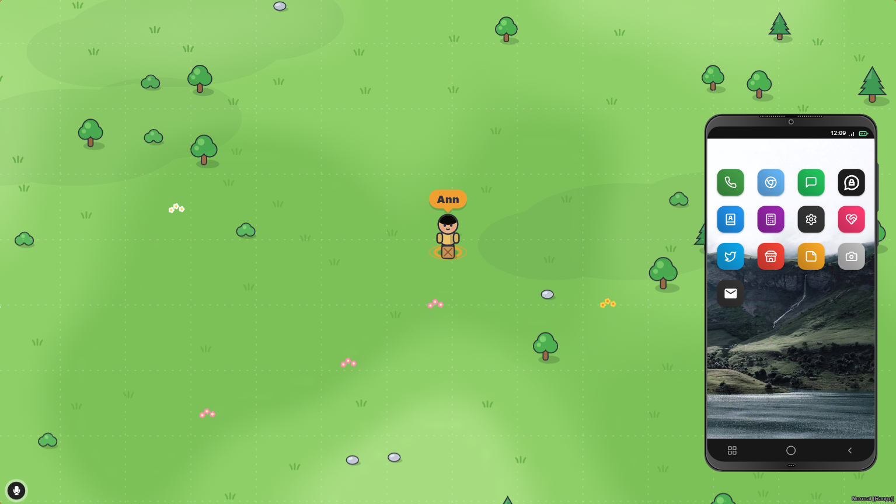

## How it works

Your scripts run on CfxLua, the Lua 5.4 runtime FiveM ships, compiled to WebAssembly: the same syntax extensions, vectors and quaternions, `json` and `msgpack`. Each resource gets its own Lua state, one per side and per player, the same isolation FiveM gives you. On top of that, FiveRunner reimplements the Cfx scripting runtime: events with `source` and net-safety, exports, function references, state bags, threads and `Wait`, and the natives API.

JavaScript runs on QuickJS, compiled to WebAssembly too, in a context for each resource on each side, with the globals of FiveM's runtime: `on`, `emit`, `exports`, `setTick` and the natives by their names. Servers also give it what bundles ask of Node, such as `require`, `Buffer` and `fs`, and the drivers of MySQL that resources carry reach FiveRunner's database on its port.

Servers also get FiveM's own `io` and `os` libraries, its VFS and file permissions, its HTTP client and server, its server variables and its console, and oxmysql, whose exports run on SQLite, which FiveRunner teaches MariaDB's SQL.

## Differences from FiveM

FiveRunner follows FiveM's Windows server and its clients down to their error messages and their quirks. Where it differs, on purpose or for now, [docs/differences.md](docs/differences.md) says so. [docs/faq.md](docs/faq.md) answers what people ask first, such as whether it is a way to play without GTA V, which it is not.

## Clean room

FiveRunner's scripting runtime is a clean-room implementation and contains no code from the FiveM platform. CfxLua, QuickJS and their libraries are open source; see [THIRD_PARTY_NOTICES.md](THIRD_PARTY_NOTICES.md). FiveRunner is not affiliated with or endorsed by Cfx.re, Rockstar Games or Take-Two Interactive.

## Contributing

Resources that behave differently than in FiveM help most. [CONTRIBUTING.md](CONTRIBUTING.md) tells how to report them, how to run FiveRunner from its source, and the rules of its clean room. [CHANGELOG.md](CHANGELOG.md) tells what each version brought.

## Spread the word

If FiveRunner saves you a restart, star it on GitHub: the stars of a project are how other FiveM developers find it.

## License

[MIT](LICENSE)
